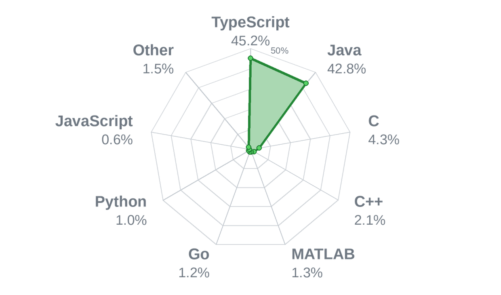

# Ali Arsalan Wafaee

I study computer science and computer engineering at UW Tacoma. I build software and embedded systems, from campus routing tools to sensor-driven prototypes.

[Portfolio](https://aliarsalanwafaee-41.github.io/sla-y-er.github.io/) · [File System Watcher](https://github.com/aliarsalanwafaee-41/file-system-watcher)

## Language usage

*Share of nonblank source lines across these four languages in selected local projects and coursework.*
